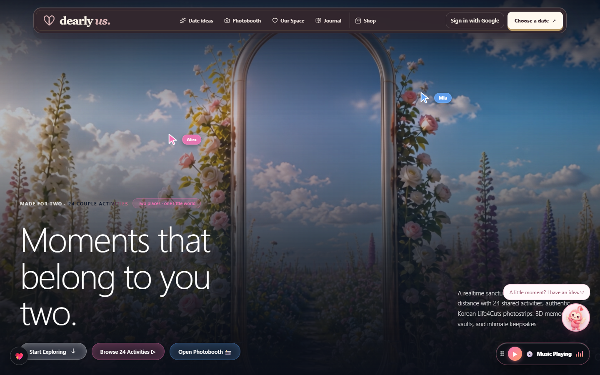
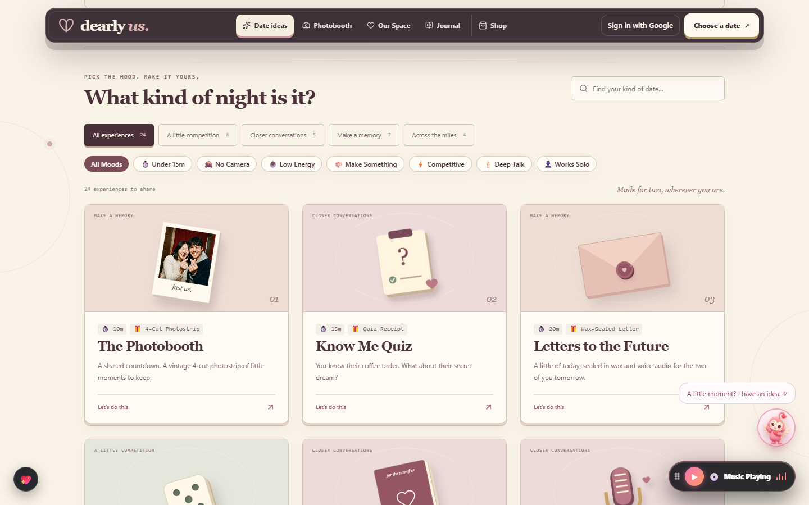
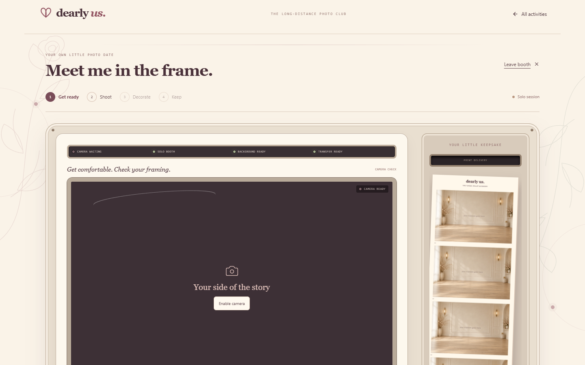
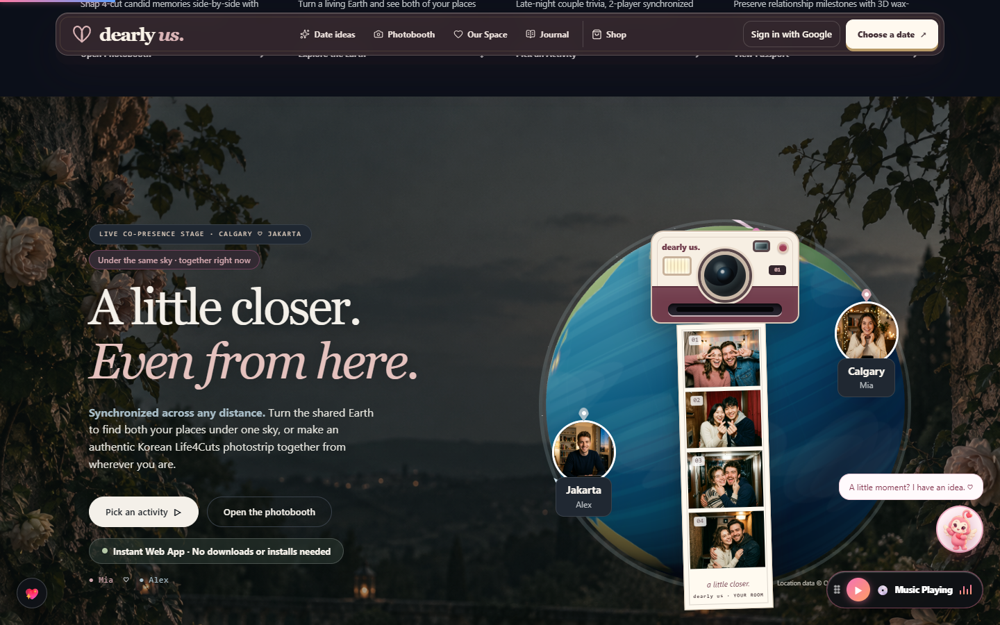
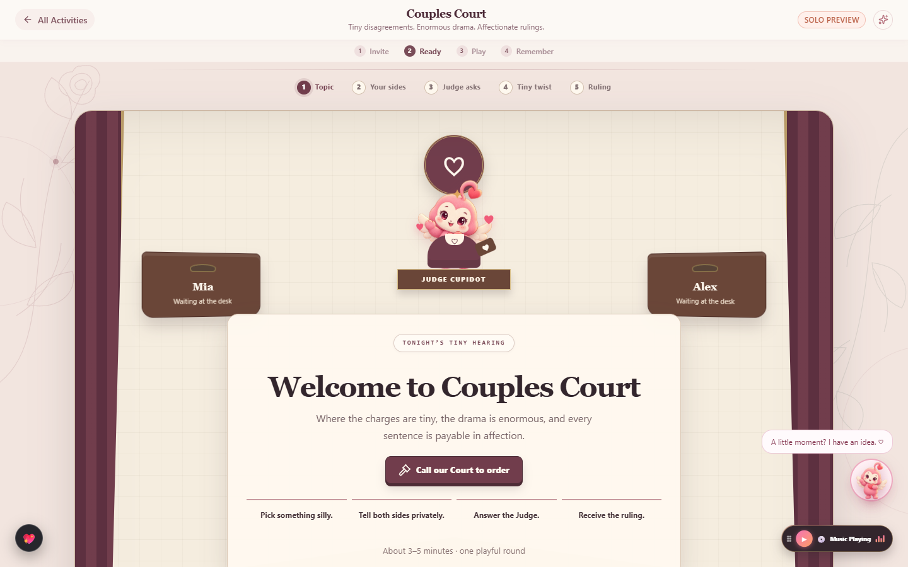
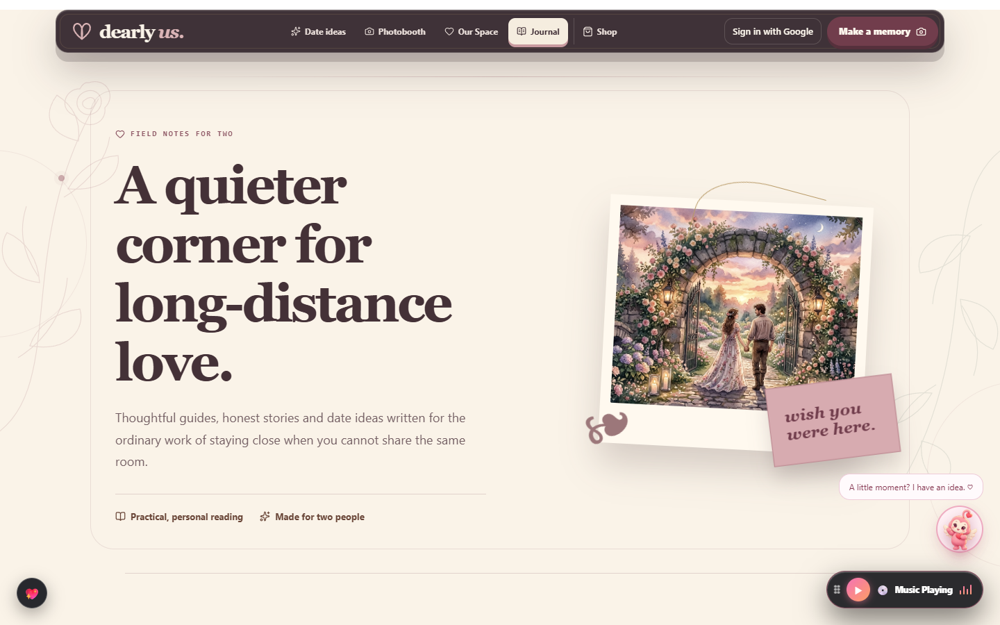

<div align="center">
  

  **A little closer, wherever you are.**

  A shared space for long-distance couples to spend time together, make things, and keep the moments that matter.

  [Explore the activities](#what-you-can-do) · [Run locally](#run-locally) · [Backend setup](#supabase-backend)
</div>



## What you can do

- **Pick a date night:** Browse 24 activities by mood, time, energy, camera use, or whether you want to talk, play, or make something.
- **Take a photostrip together:** The Photobooth supports a shared four-frame session, a solo booth, scene selection, editing, and downloadable keepsakes. A paired booth uses a private code; if direct video cannot connect, partners can continue with photo uploads.
- **Play across the distance:** Quiz, drawing, games, riddles, and the playful Couples Court give both people something to do in the same room.
- **Keep a shared space:** Signed-in couples can create profiles, connect through an invitation, and return to their private space, plans, letters, and saved memories.
- **Find ideas when you need them:** The journal offers date ideas and stories for couples who cannot always share the same room.

## A look inside

These are fresh desktop captures from the locally running site. They show public or solo-preview states; a connected couple's private data is intentionally absent.

| Choose a date | Step into the booth |
| :--- | :--- |
|  |  |
| Search and filter the activity collection. | Try the physical-booth-inspired capture flow. |

| Under one sky | A tiny courtroom |
| :--- | :--- |
|  |  |
| The homepage Earth introduces the distance between two places. | Partners tell their sides, answer the judge, and receive an affectionate ruling. |



The journal is a quieter place for guides, stories, and date ideas.

## How the project is built

Dearly Us uses React 19, TypeScript, Vinext/Vite, Three.js, and Supabase. The frontend lives in `app/`, `components/`, `contexts/`, `hooks/`, and `lib/`. Public artwork and audio live in `public/`. Tests live in `tests/`.

The `supabase/` directory is the backend source of truth: migrations define the database, policies, and storage rules; Edge Functions live in `supabase/functions/`. The browser uses publishable Supabase credentials. Service credentials and private environment files must stay out of Git.

Camera preview and background removal run on the user's device. Shared rooms and deliberately saved keepsakes use the private Supabase backend. Direct peer video is attempted without a paid relay; synchronized uploads remain available when peer video fails.

## Run locally

Requires Node.js 22.13 or newer.

```bash
git clone https://github.com/yushy07/dearlyus.git
cd dearlyus
npm install
cp .env.example .env.local
npm run dev
```

Open [http://localhost:3000](http://localhost:3000). Set `NEXT_PUBLIC_SUPABASE_URL` and `NEXT_PUBLIC_SUPABASE_PUBLISHABLE_KEY` in `.env.local` to enable sign-in and shared features. The public pages and solo previews can be explored without an account. `GEMINI_API_KEY` is optional for the Court judge; a local Court fallback handles unavailable AI.

### Supabase backend

The project keeps its versioned backend changes in `supabase/migrations/` and `supabase/functions/`. For a Supabase project you control, authenticate and link the CLI before reviewing pending migrations:

```bash
npx supabase login
npx supabase link --project-ref YOUR_PROJECT_REF
npx supabase migration list --linked
npx supabase db push --linked --dry-run
```

Review the dry run before applying database changes. The linked project's Google OAuth settings and redirect URLs must also match the URL where you run the app. Backend contracts and deployment notes are in [supabase/docs](supabase/docs).

### Checks

```bash
npx tsc --noEmit
npm run lint
npm test
npm run build
```

`npm run test:browser` runs the Playwright browser suite. Shared flows still need two distinct signed-in accounts for a real cross-device check.

## License

Licensed under the [Apache License, Version 2.0](LICENSE). Copyright © 2026 Ayush Kant.
